# Qaab security, performance and UX audit

Branch `security/red-blue-audit-hardening` · scope: `backend/`, `frontend/`, Docker files · audited from commit `3896d12` (original MVP).

## Summary

The MVP had **two critical and eight high-severity issues**: anyone could forge a session with the default
signing key, register as admin, mint wallet money through free purchases, download every paid original, upload
active content onto the API origin, and read every user's email and balance. All of them are fixed in this branch
and pinned by 43 automated security regression tests.

A second, independent review of the fixed code (Opus reviewers, every finding cross-checked by Sonnet) found
54 follow-up items (16 of them simplification suggestions), mostly regressions and deployment edge cases the
first fixes introduced. The real ones are fixed; the few left open are listed under residual risk.

Photo listing pages now run 4 SQL queries instead of 25–50, with roughly 10× lower latency.
The only control that costs more is password hashing (5× PBKDF2 iterations, rate-limited).

## Method

| Track | What was done |
|---|---|
| Red team (attack surface) | Mapped every route, input and trust boundary; built the attack tree below; probed each branch against an isolated local instance and in-process tests. |
| Blue team (controls) | Fixed each root cause at the shared choke point, added defence-in-depth (headers, limits, CSP), and turned every finding into a regression test. |
| SAST and dependencies | Two rounds of read-only multi-agent review (Opus finders, Sonnet cross-check), `npm audit`, `pip-audit`, TypeScript type check, ESLint, Next.js production build. |
| Pen test | `backend/tests/test_security.py` is the repeatable pen test: it exercises authentication, authorization, business logic, uploads, injection, headers, CORS and query bounds. |
| Performance | Back-to-back benchmark of the original and hardened backend on the same machine (SQL count per request and latency). |
| UX | Apple HIG / WWDC *Designing Fluid Interfaces* principles applied to the web (`apple-design`). |
| Simplicity | `ponytail` rules while fixing, `ponytail-review` on the diff. |
| Codebase map | `graphify` knowledge graph in `graphify-out/` (see `GRAPH_REPORT.md`). |

## Findings and status

Severity is after independent cross-checking. **Fixed** means a regression test covers it unless marked *(no test)*.

| ID | Sev | Finding | Fix |
|---|---|---|---|
| AZ-01 | Critical | Default JWT key `qaab-dev-secret-change-me` (also the compose default) lets anyone sign a session for any user | Placeholder keys refused; production requires `SECRET_KEY` ≥ 32 chars; dev generates a random key in the data dir |
| AZ-02 | Critical | Buying credited the seller without charging the buyer, repeatable without limit | Atomic conditional wallet debit (402 when short), one purchase per user+photo+license (409 and unique index), integer money math |
| AZ-06 | High | Client could set `role` (e.g. admin) at registration | Input schemas forbid unknown fields; role is server-set |
| AZ-03 | High | Full-resolution originals were public, so a purchase granted nothing | Originals stored outside `/media`; `GET /api/photos/{id}/download` only for owner or buyer; public preview 1280 px |
| AZ-04 | High | Email and wallet balance exposed on every public endpoint; avatar URL embedded the email at a third party | `PublicUserOut` for public data; random avatar seed |
| AZ-05 | High | Seeded accounts with known passwords created on every fresh deployment | Seeding only with `QAAB_SEED_DEMO=1` (off in production); sample creators get unusable passwords |
| IN-01 | High | Upload accepted any bytes, extension and size, served from the API origin | Pillow decode + re-encode to JPEG (drops EXIF/GPS and appended payloads), JPEG/PNG/WebP only, 12 MB and 50 MP caps, random server names, `nosniff` + sandbox CSP on `/media` |
| IN-02 | High | Photo `url` was free text, rendered as ``/`<a href>` (script URLs, foreign images) | Only the caller's own upload (`/media/<hex>.jpg`), 403 for others' uploads, 409 on reuse; frontend `mediaUrl` allow-lists `/media/` and `https:` |
| CF-01 | High | CORS `*` with credentials | Explicit origin list; `*` refused at startup |
| FE-01 | High | Session token in `localStorage` (readable by any injected script) | httpOnly `SameSite=Lax` cookie; Origin allow-list on cookie-authenticated writes (CSRF); token never exposed to page scripts |
| AZ-07 | Medium | Price, license and text fields unvalidated (negative/zero prices, unknown licenses, unbounded strings) | Bounded schemas; `license` is `standard` or `extended` |
| AZ-08 | Medium | Anyone could list another creator's uploaded file | `Upload` ownership table |
| AZ-09 | Medium | No login/register throttling; timing revealed which emails exist | O(1) in-memory rate limits (login per IP and per account, register, upload, buy) with `Retry-After`; dummy-hash path for unknown emails |
| AZ-10 | Medium | 7-day tokens, no server-side logout | 24 h TTL, `iat`/`exp`/`sub` required, `token_version` revocation on logout |
| AZ-11 | Medium | Duplicate likes and lost-update counters | Unique index on (user, photo); atomic SQL counters |
| AZ-12 | Medium | Missions accepted missing/closed missions and unlimited entries | 404/409 checks, 10 entries per user per mission, foreign keys on |
| AZ-13 | Medium | Seller balance and sales updated by read-modify-write | `UPDATE … SET balance = balance + :x` in one transaction |
| AZ-14 | Medium | No password policy; PBKDF2 at 120k iterations | 8–128 chars; 600k iterations with transparent rehash on login |
| CF-02 | Medium | No security headers on API or web | Pure-ASGI header middleware (API) and `headers()` with CSP in `next.config.ts` |
| CF-03 | Medium | Unbounded request bodies parsed before any check | Content-Length gate: 64 KB JSON, 12 MB upload, 411 without length |
| CF-04 | Medium | `next` 15.5.25 and bundled PostCSS advisories; Starlette 0.41 advisories (multipart, static-file `Range`); 24 Pillow 12.3 advisories | Next 15.5.28 with patched PostCSS; FastAPI 0.143 / Starlette 1.8; Pillow 13.0.0 |
| AZ-15 | Medium | Public stats inflated by a hard-coded 4.82B and ×380/×1400/×14 multipliers | Real counts only *(no test)* |
| AZ-16 | Low | Pagination caps bypassable (negative offset, unbounded creator list, long search) | `ge`/`le` bounds, 100-char search with literal LIKE wildcards |
| CF-05 | Low | API container ran as root; `/docs` always public | Non-root user, Docker `HEALTHCHECK`; docs off in production *(no test)* |
| PF-01 | Perf | N+1 queries in photo serialization (25 anon / 50 signed-in per page) | Batched author and like lookups: 4 queries |
| PF-02 | Perf | SQLite without WAL/busy timeout | WAL, `busy_timeout`, `synchronous=NORMAL`, indexes for sort columns |
| PF-03 | Perf | Full-viewport `filter: blur(90px)` re-rasterized on every animation frame | Radial gradients, transform-only animation that stops after one cycle |

### Second round (review of the fixed code)

| Area | What the review found | Fix |
|---|---|---|
| Deployment | Existing root-owned Docker volumes would crash-loop the non-root image | Entrypoint fixes ownership once, then drops to uid 10001 with `setpriv` |
| Deployment | Old databases kept the published sample passwords (and spendable balances) | Startup locks the sample creators, and the demo outside development, and ends their sessions |
| Deployment | `QAAB_SEED_DEMO=1` still seeded the demo in production; UI and API could disagree | Demo is impossible in production; `/api/health` tells the login page |
| Deployment | Per-IP limits shared one bucket behind Docker or a proxy | `FORWARDED_ALLOW_IPS` passed through and documented; warning at startup in production |
| Wallet | Double-clicked Buy could charge twice on databases with legacy duplicates | Duplicate check repeated inside the write transaction |
| Auth | Login limiter could be raced; anyone could lock an account out | Atomic check-and-count before hashing; strict limit per account+IP, loose per account |
| Auth | Browser still received the bearer token | Token omitted for web-origin requests |
| Uploads | Camera JPEGs (MPO) rejected; ICC profile dropped or oversized (8 MB thumbnails possible) | MPO accepted; small RGB profiles kept, others dropped |
| Uploads | Parallel large decodes could exhaust memory, then queued uploads could starve request threads | 2 decode slots with a 3 s wait, then 503 + `Retry-After` |
| Uploads | Unpublished uploads could fill the disk | 20 unpublished uploads per 24 h |
| Uploads | Pre-release uploads stayed public at full size with GPS | Migrated into private originals at startup, committed before the old file is deleted |
| Integrity | Parallel publishes could duplicate a photo or pass the mission entry cap | Partial unique index on upload URLs; entry count inside the write transaction |
| Resources | Downloads and logins held a DB connection during file streaming or hashing; pool smaller than thread pool | Connection released first; pool ≥ thread pool; one hash per core (503 when saturated) |
| Resources | Anonymous 12 MB uploads were parsed before auth | Rejected at the edge without credentials |
| Durability | `synchronous=NORMAL` could lose a confirmed purchase on power loss | `synchronous=FULL` |
| Frontend | Global CSS outranked Tailwind utilities, hiding validation and selected states | Moved into `@layer base` |
| Frontend | Expired or revoked sessions looked signed in; errors in raw English; endless skeletons | 401 broadcast drops the session; 422/5xx/offline messages localized; not-found states |
| Frontend | Post-login redirect could be steered off-site with tab/backslash tricks | `next` resolved with `URL` and required to be same-origin |
| Frontend | Purchase debited in one tap with no balance shown; extended license unreachable after standard | Balance shown, shortfall explained, confirm step, per-license purchase, in-page download |

## Attack tree

Root goal: **take money or paid content from Qaab, or its users' data.** Every leaf was reachable with low effort
and no special skill before this branch. The right column is the control that now closes it.

```mermaid
graph TD
  R["Steal money, paid content or user data"]
  R --> A["Take over an account"]
  R --> B["Mint wallet balance"]
  R --> C["Get paid originals free"]
  R --> D["Abuse uploads"]
  R --> E["Harvest personal data"]
  R --> F["Exhaust resources"]
  A --> A1["Sign own session token<br/>(default key)"] --> A1x["Key required, placeholders refused"]
  A --> A2["Guess passwords"] --> A2x["Rate limits, 8+ chars, PBKDF2 600k"]
  A --> A3["Use seeded passwords"] --> A3x["Seed gated, unusable sample passwords"]
  A --> A4["Read token via injected script"] --> A4x["httpOnly cookie, CSP, URL allow-list"]
  A --> A5["Ride the session cross-site"] --> A5x["SameSite=Lax + Origin allow-list"]
  B --> B1["Buy without paying"] --> B1x["Atomic wallet debit"]
  B --> B2["Repeat or race purchases"] --> B2x["Unique purchase, atomic SQL"]
  B --> B3["Register as admin"] --> B3x["Unknown fields rejected"]
  C --> C1["Fetch public original URL"] --> C1x["Private originals, buyer-only download"]
  C --> C2["Scrape the catalogue"] --> C2x["Bounded pagination"]
  D --> D1["Serve active content from API origin"] --> D1x["Re-encode, nosniff, sandbox CSP"]
  D --> D2["Huge or bomb images"] --> D2x["Body, byte and pixel limits"]
  D --> D3["Sell someone else's upload"] --> D3x["Upload ownership"]
  E --> E1["Enumerate emails and balances"] --> E1x["Public schema"]
  E --> E2["Read GPS from photo EXIF"] --> E2x["Metadata stripped"]
  F --> F1["Hash-heavy login flood"] --> F1x["Per-IP and per-account limits"]
  F --> F2["Expensive list queries"] --> F2x["Batched queries, caps"]
```



## Blue-team notes

- **Detection.** 401, 403 and 429 responses are the signals to alert on: bursts of 429 on `/api/auth/login` (guessing), 403 "Untrusted origin" (cross-site attempts), 415/413 on `/api/upload` (probing). Ship the uvicorn access log to your log stack.
- **Rate limits are per process.** They hold for the single uvicorn worker this app runs. Move them to Redis before adding workers.
- **Behind a reverse proxy**, keep `--proxy-headers` and set `--forwarded-allow-ips` to the proxy address, or every client shares one rate-limit bucket.
- **Same-site deployment.** The session cookie is `SameSite=Lax`, so the web app and API must share a registrable domain (e.g. `qaab.ir` and `api.qaab.ir`). Locally, open the site at `localhost`, not `127.0.0.1`, to match the API URL.
- **Existing databases** are migrated in place at startup (new column, indexes, duplicate likes removed, legacy uploads made private, sample accounts locked). Existing passwords upgrade to 600k iterations on the next login.
- **503 + Retry-After** on login or upload means the hash or image slots are saturated: a burst, or an attack. Alert on sustained 503s.
- **Compose defaults to development** for local use. On a server set `APP_ENV=production`; the API then refuses to start without a real `SECRET_KEY`.

## Performance

Measured in-process, original code with its original dependencies, then this branch, back to back on the same
machine. The machine was heavily loaded (load average ~45 on 4 cores), so absolute times are inflated; compare ratios.

| Request | SQL before | SQL after | p50 before | p50 after |
|---|---|---|---|---|
| `GET /api/photos?limit=24` anonymous | 25 | 4 | 327 ms | 27 ms |
| `GET /api/photos?limit=24` signed in | 50 | 4 | 475 ms | 24 ms |
| `GET /api/creators` | 1 | 1 | 34 ms | 10 ms |
| `GET /api/stats` | 4 | 4 | 47 ms | 13 ms |
| `POST /api/auth/login` | 1 | 1 | 722 ms | 2,201 ms |

How each security control stays cheap:

- **Headers and body limit** are pure ASGI with header lists built once at import; no per-request allocation beyond one list concat.
- **Rate limiter** is a fixed-window dict, O(1) per check, memory-bounded.
- **Login** costs about 3× more here (5× iterations) by design. Hashing is capped at one per core and the DB connection is released before it starts, so a login burst queues briefly instead of blocking other requests. Sample accounts no longer hash a password at startup.
- **Image processing** has two slots and fails fast with 503, so uploads cannot starve the request threads.
- **`/api/stats`** is cached for 60 s; GZip runs at level 6.
- **GZip** for JSON over 1 KB; `/media` files are immutable and cached for a year.
- **Uploads** decode once and write a 1280 px preview and 640 px thumbnail, so listing pages no longer send full-size images.

## UX changes (Apple HIG on the web)

- Critically damped springs replace long tweens; cards and sections settle without overshoot and stay interruptible.
- Press feedback starts on pointer-down (75 ms scale) instead of after a 300 ms transition.
- `MotionConfig reducedMotion="user"`, plus CSS for reduced motion, reduced transparency (solid glass) and increased contrast.
- Visible `:focus-visible` rings; 44 px touch targets on coarse pointers; the like button is reachable by keyboard and touch (it was hover-only and nested inside a link).
- The mobile menu is a real dialog: Escape closes it, focus starts on Close, labels are translated.
- Inline upload validation (type and size) before sending; server errors are shown in the page language; purchase shows busy, success and download states.
- Typography: tight tracking and leading only for Latin display text; Persian, a joined script, keeps natural spacing and taller leading.
- Purchases show the wallet balance and the shortfall, and ask for confirmation before money moves (Apple: confirm only irreversible actions).
- Native `<details>` FAQ, menu dialog with scroll lock and focus return, `aria-pressed` on filter chips and tabs.
- The hero headline and the photo-page image render immediately (no fade-in before hydration), which speeds up the largest paint.

## Residual risk and recommendations

1. **Payments.** The wallet model is a stand-in. Integrate an Iranian payment gateway with pending purchases settled by verified callback before real money moves.
2. **CSP nonces.** Scripts still allow `'unsafe-inline'` because Next.js and next-themes inject bootstrap scripts. Move to nonce-based CSP via middleware when pages can render dynamically.
3. **Next.js 16.** Next 15 vendors PostCSS 8.4.31 (build-time advisories); an override pins 8.5.x. Upgrading to Next 16 removes the override.
4. **Dev-only advisory.** `braces` (via `eslint-config-next`) has no patched release yet; it only affects linting. Production dependencies: `npm audit --omit=dev` and `pip-audit` report none.
5. **Self-host fonts** (Vazirmatn, Outfit) to drop the Google Fonts dependency, which is slow or blocked for many Iranian users and is a third-party request.
6. **Watermarked previews** and **email verification** before selling, to slow down content theft and sock-puppet accounts.
7. **Legal pages.** About, Contact, Help, Privacy and Terms link to `#`, including the terms a user accepts at sign-up.
8. **Forms and copy.** Required-field messages still come from the browser (in the browser's language), the
   menu dialog has no full focus trap, and the Persian copy mixes informal and formal address.
9. **Upload cleanup.** Abandoned uploads stay on disk; add a daily job that deletes unpublished uploads older than a day.

## How to verify

```bash
cd backend && .venv/bin/python -m pip install -r requirements-dev.txt
.venv/bin/python -m pytest -q -p no:cacheprovider tests      # 43 security regression tests
cd ../frontend && npx tsc --noEmit && npx eslint app components lib && npm run build
```
